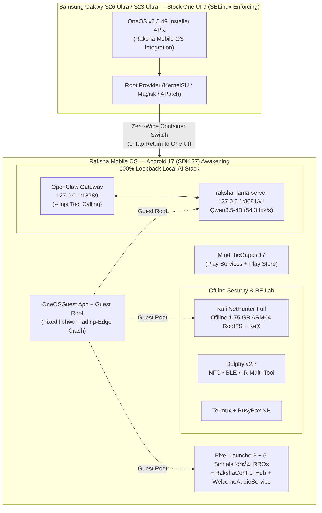

<div align="center">



<p>
  <a href="#-quick-install-guide"></a>
  <a href="https://github.com/fahadalijaved/OneOS"></a>
  <a href="#-on-device-ai--openclaw"></a>
  <a href="#-security--rf-hardware-lab"></a>
  <a href="ATTRIBUTIONS.md"></a>
</p>

<h3>
  <b>A Sovereign Android 17 AI &amp; Cybersecurity Mobile OS — Running Live Beside Stock Samsung One UI.</b>
</h3>

<p>
  <a href="#-highlights">Highlights</a> •
  <a href="#-architecture">Architecture</a> •
  <a href="#-quick-install-guide">Install</a> •
  <a href="#-on-device-ai--openclaw">Local AI</a> •
  <a href="#-privacy--upstream-oneos-backend">Privacy &amp; OneOS Backend</a> •
  <a href="ATTRIBUTIONS.md">Attributions</a>
</p>

</div>

---

<div align="center">



</div>

---

## ⚡ Highlights

| Capability | What's Baked Into `RakshaMobileOS17_Awakening` |
|---|---|
| **Zero-Wipe Dual-Boot** | Powered by **[OneOS `v0.5.49`](https://github.com/fahadalijaved/OneOS)** — boots full Android 17 cleanly beside stock Samsung One UI 9 and returns in-place without flashing or wiping partitions. |
| **On-Device Local LLM** | **Qwen3.5-4B (`Q4_K_M`, 2.6 GB)** + native ARM64 **`llama.cpp`** (`b12633`) serving `http://127.0.0.1:8081/v1` — benchmarked live on Galaxy S26 Ultra at **54.3 tok/s prompt** / **14.7 tok/s generation** (**0.79 s** first response, 0 bytes to the cloud). |
| **Autonomous OpenClaw Agent** | Local loopback **OpenClaw** (`127.0.0.1:18789`) + **OpenClaw Android** + **ClawCompanion** pre-wired to `raksha-qwen3.5-4b` with full `--jinja` tool-calling support. |
| **Full Offline Kali NetHunter** | **NetHunter**, **NetHunter Terminal**, **NetHunter KeX**, static ARM64 `busybox_nh`, and the **1.75 GB Full Kali ARM64 RootFS** baked offline with 1-tap deployment via `raksha-kali-install`. |
| **Wireless & RF Hardware Lab** | **[Dolphy v2.7](https://github.com/unvoiddd/Dolphy-App)** (NFC, BLE, IR research & hardware emulation, GPL-3.0) pre-installed with all 10 `arm64-v8a` native libraries extracted. |
| **Pixel Feel + Sinhala "රාක්ෂ" Identity** | Pixel `Launcher3QuickStep`, full-screen `1440×3120` neon-cyan Sinhala boot animation + audible awakening sound (`WelcomeAudioService`), 5 regional-locale-complete branding RROs (`en_AU` / `en_GB` / `en_US`), and zero residual crDroid setup stats. |
| **Daily-Driver Ready** | **MindTheGapps 17** (Google Play Services + Play Store), **OneOS Guest Root** (with our `libhwui` fading-edge crash fix for AOSP/crDroid guests), **Termux**, **RootlessJamesDSP**, and **F-Droid**. |

---

## 🧬 Architecture



---

## 📱 Supported Devices & Verification

| Device | Model | SoC | OneOS Profile | Status |
|---|---|---|---|---|
| **Samsung Galaxy S26 Ultra** | `SM-S948B` | Snapdragon 8 Elite Gen 5 | `s-ultra-8850` | ✅ Booted & Verified (Daily-Driver + Local LLM + OneOSGuest + Guest Root) |
| **Samsung Galaxy S23 Ultra** | `SM-S918B` | Snapdragon 8 Gen 2 | `s-ultra-8550` | ✅ Booted & Verified |

---

## 🚀 Quick Install Guide

<details open>
<summary><b>Click to expand / collapse — Step-by-Step Installation on One UI 9</b></summary>

### Prerequisites
- A rooted **Galaxy S26 Ultra** or **Galaxy S23 Ultra** running stock **One UI 9 (Android 17)** with KernelSU / Magisk / APatch.
- At least **20 GB free internal storage** (for staging the compressed + raw system image).

### Step 1 — Download & Reassemble the Release Artifacts
Grab all verified assets from the **[`v1.0-awakening` Release](https://github.com/PasanRS/Raksha-Mobile-OS/releases/tag/v1.0-awakening)**:
- **[`OneOS-0.5.49-RakshaMobileOS.apk`](https://github.com/PasanRS/Raksha-Mobile-OS/releases/download/v1.0-awakening/OneOS-0.5.49-RakshaMobileOS.apk)** *(237 MB, offline self-contained installer built on OneOS `v0.5.49`)*
- **`RakshaMobileOS17_Awakening.img.gz.part00` – `.part28`** *(29 × `250 MiB` chunks for reliable resumable downloads; reassembles to the exact 6.89 GiB AVB RSA2048 + sha256 hashtree verified image)*
- **[`SHA256SUMS.txt`](https://github.com/PasanRS/Raksha-Mobile-OS/releases/download/v1.0-awakening/SHA256SUMS.txt)** *(checksum manifest for every file)*

**One-command download, reassemble & verify (Linux / macOS / Termux on-phone):**
```bash
BASE="https://github.com/PasanRS/Raksha-Mobile-OS/releases/download/v1.0-awakening"
curl -fL -C - -O "$BASE/OneOS-0.5.49-RakshaMobileOS.apk" -O "$BASE/SHA256SUMS.txt"
for i in $(seq -w 0 28); do
  curl -fL -C - -O "$BASE/RakshaMobileOS17_Awakening.img.gz.part$i"
done

cat RakshaMobileOS17_Awakening.img.gz.part* > RakshaMobileOS17_Awakening.img.gz
sha256sum -c SHA256SUMS.txt
# Expected SHA-256:
# RakshaMobileOS17_Awakening.img.gz : 5f4815fc7977acaaee4707b9faf07f09ab612b7c078d7678e050d08b1caac978
# OneOS-0.5.49-RakshaMobileOS.apk   : 1c1cd47a2232096d24eed24b5b9208725fe147208fb8e05fc01b8cdd5eaccec4
```
```cmd
:: Windows Command Prompt (after downloading all .part00-.part28 into one folder):
copy /b RakshaMobileOS17_Awakening.img.gz.part* RakshaMobileOS17_Awakening.img.gz
certutil -hashfile RakshaMobileOS17_Awakening.img.gz SHA256
```

### Step 2 — Stage & Boot
1. Install **`OneOS-0.5.49-RakshaMobileOS.apk`** on One UI and grant root access.
2. Choose **Raksha Mobile · Awakening** → select **`RakshaMobileOS17_Awakening.img.gz`** → tap **Start fresh / New stage**.
3. Tap **Switch** — watch the full-screen `1440×3120` Sinhala awakening animation and complete the single clean Raksha Setup Wizard.
4. Once on the desktop, open **OneOS → Guest root** to grant root to **Raksha Control**, **NetHunter**, and **Termux**.

> **Tip — Returning to One UI**: Open the **OneOS** app inside Raksha Mobile OS and tap **Back to One UI** (or hold **Volume Up + Volume Down for 3 seconds** at any time).

</details>

---

## 🧠 On-Device AI & OpenClaw

<details>
<summary><b>Click to expand — Running Local Qwen3.5-4B + OpenClaw (`127.0.0.1`)</b></summary>

1. **Start the local inference server**:
   - Tap **Start Local LLM** in **Raksha Control**, *or* run in Termux:
     ```bash
     su -c '/system/bin/raksha-llama-server start'
     ```
2. **Verify health**:
   ```bash
   curl -s http://127.0.0.1:8081/health
   # {"status":"ok"}
   curl -s http://127.0.0.1:8081/v1/models
   ```
3. **Wire OpenClaw to your local model** (`~/.openclaw/openclaw.json`):
   ```json
   {
     "models": {
       "providers": {
         "raksha-local": {
           "baseUrl": "http://127.0.0.1:8081/v1",
           "apiKey": "raksha-local",
           "api": "openai-completions",
           "models": [
             {
               "id": "raksha-qwen3.5-4b",
               "name": "Raksha Qwen3.5-4B (Local)",
               "contextWindow": 16384,
               "maxTokens": 4096,
               "input": ["text"]
             }
           ]
         }
       }
     },
     "agents": {
       "defaults": {
         "model": { "primary": "raksha-local/raksha-qwen3.5-4b" }
       }
     }
   }
   ```
4. Launch **`openclaw gateway`** and open **`http://localhost:18789`**.

> **Why `--reasoning-budget 0 --parallel 1 --flash-attn on`?**
> On Snapdragon 8 Elite Gen 5, single-slot Flash Attention with zero hidden thinking delay prevents zRAM swap thrashing and delivers **54.3 tok/s prompt eval** and **14.7 tok/s generation** (~0.79 s response latency) with immediate non-empty `content` tokens for OpenClaw.

</details>

---

## 🛡️ Security & RF Hardware Lab

<details>
<summary><b>Click to expand — Deploying Full Offline Kali NetHunter &amp; Using Dolphy v2.7</b></summary>

### 1-Tap Full Kali NetHunter Deployment (100% Offline)
The 1.75 GB `kali-nethunter-rootfs-full-arm64.tar.xz` is already baked inside `/system/etc/raksha/kali/`.
- Open **Raksha Control** → tap **Deploy Full Kali**, *or* run:
  ```bash
  su -c '/system/bin/raksha-kali-install'
  ```
- Open **NetHunter**, **NetHunter Terminal**, or **NetHunter KeX** once extraction finishes.

### Dolphy v2.7 (NFC / BLE / IR Multi-Tool)
- Pre-installed out of the box (`com.droid.dolphy`) — no root required for standard NFC/BLE/IR research workflows.
- Upstream source: [unvoiddd/Dolphy-App](https://github.com/unvoiddd/Dolphy-App) (GPL-3.0).

</details>

---

## 🔒 Privacy, Telemetry & Upstream OneOS Backend Transparency

<details>
<summary><b>Click to expand — How Raksha Mobile OS Handles Reporting, Updates &amp; Upstream OneOS</b></summary>

- **Zero silent reporting to upstream OneOS**: Upstream OneOS's `ReportSender` and `UsageCheckIn` only activate when compiled with the upstream maintainer's private `REPORT_URL` and `REPORT_KEY` build secrets. Community/self-built Raksha Mobile OS APKs do **not** include those keys, so **no telemetry or automatic reports are ever sent to `fahadalijaved/OneOS`**.
- **Manual diagnostic logs**: **OneOS → Settings → Last session** still generates redacted local log zips on-device (`oneos-logs-*.zip`) that *you* control and can share manually on our GitHub Issues when troubleshooting.
- **No crDroid statistics / telemetry**: `RakshaSetupWizardBranding` skips the upstream crDroid telemetry/recovery wizard pages completely, and `RakshaLineagePartsBranding` overrides the telemetry endpoint to a local non-routable URI.
- **100% Loopback Local AI**: Both `raksha-llama-server` (`127.0.0.1:8081`) and `openclaw` (`127.0.0.1:18789`) bind exclusively to loopback (`127.0.0.1`) — never exposed on Wi-Fi or cellular interfaces.
- **Upstream OneOS Auto-Updater**: Upstream `AppUpdate.kt` checks `fahadalijaved/OneOS` releases by default, and enforces matching APK signing certificates before installing — so vanilla upstream APKs cannot silently overwrite your Raksha Mobile OS installer.

</details>

---

## 🛠️ Repository Layout & Building From Source

<details>
<summary><b>Click to expand — Source Tree &amp; Reproducing the OneOS v0.5.49 Integration</b></summary>

```text
Raksha-Mobile-OS/
├── assets/                     # Animated SVG banners, Neon Cobra Emblem, Sinhala logotypes
├── raksha/
│   ├── rros/                   # 5 static Android 17 branding RROs (all en_* locales)
│   │   ├── RakshaPlatformBranding/
│   │   ├── RakshaSettingsBranding/
│   │   ├── RakshaSetupWizardBranding/
│   │   ├── RakshaLauncherBranding/
│   │   └── RakshaLineagePartsBranding/
│   ├── control/                # Native RakshaControl hub + WelcomeAudioService source
│   └── scripts/                # raksha-llama-server, raksha-kali-install, openclaw-config.json
├── oneos-patch/                # Clean source diffs against official fahadalijaved/OneOS
│   ├── raksha-mobile-os-v0.5.49.patch
│   ├── raksha-mobile-os-v0.5.36.patch
│   ├── os_raksha.xml
│   ├── raksha.guards.txt
│   └── raksha.sha256
├── ATTRIBUTIONS.md             # Full upstream credits & licenses
└── LICENSE                     # Apache License 2.0 (for Raksha Mobile OS original code)
```

### Applying Our Patch to Upstream OneOS `v0.5.49`
```bash
git clone --depth 1 --branch v0.5.49 https://github.com/fahadalijaved/OneOS.git
cd OneOS
git apply /path/to/Raksha-Mobile-OS/oneos-patch/raksha-mobile-os-v0.5.49.patch
cp /path/to/Raksha-Mobile-OS/oneos-patch/os_raksha.xml app-android/app/src/full/res/drawable/
cp /path/to/Raksha-Mobile-OS/oneos-patch/os_raksha.xml app-android/guest/src/main/res/drawable/
cp /path/to/Raksha-Mobile-OS/oneos-patch/raksha.guards.txt app-android/packages/
cp /path/to/Raksha-Mobile-OS/oneos-patch/raksha.sha256 app-android/packages/
```

</details>

---

## 🙏 Credits & Upstream Projects

Built with deep gratitude to **[Fahad Ali Javed / OneOS](https://github.com/fahadalijaved/OneOS)**, **[WeWaffles / OneLineage](https://github.com/WeWaffles/OneLineage)**, **[MysticGSI](https://github.com/MysticGSI/mysticgsi)**, **[crDroid](https://github.com/crdroidandroid)**, **[LineageOS](https://github.com/LineageOS)**, **[Kali NetHunter](https://www.kali.org/get-kali/#kali-mobile)**, **[llama.cpp](https://github.com/ggml-org/llama.cpp)**, **[Qwen](https://huggingface.co/Qwen)**, **[OpenClaw](https://github.com/openclaw/openclaw)**, **[Dolphy (`unvoiddd`)](https://github.com/unvoiddd/Dolphy-App)**, **[Termux](https://github.com/termux/termux-app)**, **[RootlessJamesDSP](https://github.com/ThePBone/RootlessJamesDSP)**, **[JingMatrix (NeoZygisk & Vector)](https://github.com/JingMatrix)**, and **[MindTheGapps](https://gitlab.com/MindTheGapps/vendor_gapps)**.

See **[ATTRIBUTIONS.md](ATTRIBUTIONS.md)** for the full license & attribution table.

<div align="center">
  <br/>
  
  <br/>
  <sub><b>Raksha Mobile OS</b> — Maintained by <a href="https://github.com/PasanRS">PasanRS</a></sub>
</div>
